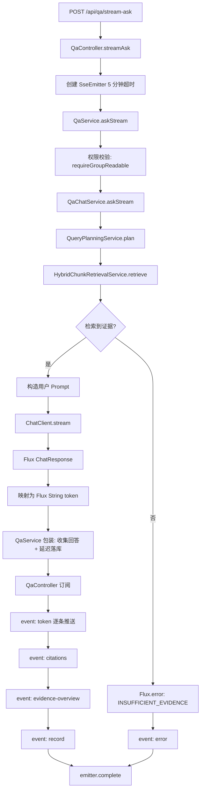

# 流式 QA 问答实现说明

> 适用版本：V4.1  
> 代码入口：`QaController.streamAsk`  
> 核心链路：Spring MVC `SseEmitter` + Reactor `Flux` + Spring AI `ChatClient`  
> 文档日期：2026-11-03

---

## 目录

- [1. 概述](#1-概述)
- [2. 总体流程](#2-总体流程)
- [3. 入口层：QaController.streamAsk](#3-入口层qacontrollerstreamask)
- [4. 服务层：QaService.askStream](#4-服务层qaserviceaskstream)
- [5. 问答核心：QaChatService.askStream](#5-问答核心qachatserviceaskstream)
- [6. 检索链路](#6-检索链路)
- [7. Prompt 与 RAG Advisor](#7-prompt-与-rag-advisor)
- [8. SSE 事件协议](#8-sse-事件协议)
- [9. 持久化与历史记录](#9-持久化与历史记录)
- [10. 前端消费方式](#10-前端消费方式)
- [11. 错误处理与连接生命周期](#11-错误处理与连接生命周期)
- [12. 关键设计决策](#12-关键设计决策)
- [13. 已知问题与改进建议](#13-已知问题与改进建议)
- [14. 关键代码索引](#14-关键代码索引)
- [附录：SSE 报文示例](#附录sse-报文示例)

---

## 1. 概述

流式知识问答接口 `POST /api/qa/stream-ask` 用于在指定群组的知识库范围内提问，并通过 SSE（Server-Sent Events）逐 token 推送大模型生成的回答。

与同步接口 `POST /api/qa/ask` 相比，两者共享同一套 RAG 流程：

```
权限校验 → 查询规划 → 混合检索 → 证据评估 → Prompt 构造 → 大模型生成 → 引用组装
```

区别在于：

| 对比项 | 同步问答 `/ask` | 流式问答 `/stream-ask` |
|---|---|---|
| 返回方式 | `AskQuestionResponse` JSON | `SseEmitter`，`text/event-stream` |
| 大模型调用 | `call().chatResponse()` | `stream().chatResponse()` |
| 回答正文 | 一次性返回 | 按 token 增量推送 |
| 持久化时机 | 调用结束后立即保存 | token 流结束后延迟保存 |
| recordId | 直接放在响应体中 | 通过 `record` SSE 事件返回 |
| 输出格式 | 结构化 JSON（`KnowledgeAnswerOutput`） | 纯文本 |

整体实现分为三段：

1. **同步准备阶段**：权限校验、查询规划、混合检索、证据评估、Prompt 构造。
2. **流式生成阶段**：调用 Spring AI 的 `ChatClient.stream()`，得到 `Flux<ChatResponse>`，再映射为 `Flux<String>` token。
3. **SSE 推送阶段**：Controller 订阅 token 流，逐条 `emitter.send()`；结束后发送引用、证据概览和记录 ID。

---

## 2. 总体流程



### 事件顺序

正常回答：

```
token × N
citations          （仅当引用列表非空）
evidence-overview  （仅当证据概览非空）
record             （仅当持久化成功、recordId 非空）
连接关闭
```

异常回答：

```
token × N（可能已经收到一部分）
error
连接关闭
```

---

## 3. 入口层：`QaController.streamAsk`

文件：`Argus-backend/src/main/java/com/argus/rag/qa/controller/QaController.java`

### 3.1 方法签名

```java
@PostMapping("/stream-ask")
public SseEmitter streamAsk(
        @Valid @RequestBody AskQuestionRequest askQuestionRequest,
        HttpServletRequest request) {
```

- `@Valid` 负责 `groupId`、`question` 的基础校验。
- 校验失败时不会进入方法，而是由 `GlobalExceptionHandler` 返回普通 JSON 400。
- 方法返回 `SseEmitter`，Spring MVC 会将其识别为异步请求，响应类型为 `text/event-stream`。

### 3.2 创建 SseEmitter

```java
private static final long SSE_TIMEOUT_MS = 300_000L;

SseEmitter emitter = new SseEmitter(SSE_TIMEOUT_MS);

emitter.onCompletion(() -> log.debug("SSE 连接正常完成"));
emitter.onTimeout(() -> log.warn("SSE 连接超时"));
emitter.onError(error -> log.error("SSE 连接异常", error));
```

- 超时时间：5 分钟。
- 三个回调目前只记录日志，没有取消上游 Flux 订阅。

### 3.3 同步准备

```java
QaChatService.StreamContext streamContext =
        qaService.askStream(request, askQuestionRequest);
```

注意：这一步是**同步阻塞**的。

在 Controller 返回 `SseEmitter` 之前，已经完成了：

- 群组读权限校验；
- 当前用户身份获取；
- 查询规划（一次大模型调用）；
- 向量检索；
- 关键词检索；
- You.com 网络搜索（如果启用）；
- 证据等级评估；
- Prompt 构造。

因此首 token 的延迟包含整个 RAG 检索耗时。

### 3.4 订阅 token 流

```java
streamContext.tokenStream()
        .doOnNext(token -> {
            try {
                emitter.send(SseEmitter.event()
                        .name("token")
                        .data(token));
            } catch (IOException e) {
                throw new RuntimeException("SSE 发送 token 失败", e);
            }
        })
        .doOnComplete(() -> {
            try {
                // 1. citations
                List<AskQuestionResponse.Citation> citations =
                        citationAssembler.assembleDocuments(streamContext.documents());
                if (!citations.isEmpty()) {
                    emitter.send(SseEmitter.event()
                            .name("citations")
                            .data(citations));
                }

                // 2. evidence-overview
                AskQuestionResponse.EvidenceOverview evidenceOverview =
                        evidenceOverviewAssembler.assemble(streamContext.documents());
                if (evidenceOverview != null) {
                    emitter.send(SseEmitter.event()
                            .name("evidence-overview")
                            .data(evidenceOverview));
                }

                // 3. record
                Long recordId = streamContext.recordId();
                if (recordId != null) {
                    emitter.send(SseEmitter.event()
                            .name("record")
                            .data(Map.of("recordId", recordId)));
                }

                emitter.complete();
            } catch (IOException e) {
                log.error("SSE 发送 citations 失败", e);
                emitter.completeWithError(e);
            }
        })
        .doOnError(error -> {
            log.error("流式问答 token 流异常", error);
            try {
                String message = error.getMessage() != null
                        ? error.getMessage()
                        : "流式问答服务内部错误";
                emitter.send(SseEmitter.event()
                        .name("error")
                        .data(Map.of("message", message)));
                emitter.complete();
            } catch (IOException e) {
                emitter.completeWithError(e);
            }
        })
        .subscribe();
```

### 3.5 同步异常兜底

```java
try {
    QaChatService.StreamContext streamContext =
            qaService.askStream(request, askQuestionRequest);
    // ...
} catch (Exception e) {
    log.error("流式问答初始化失败", e);
    try {
        String message = e.getMessage() != null ? e.getMessage() : "请求处理失败";
        emitter.send(SseEmitter.event()
                .name("error")
                .data(Map.of("message", message)));
        emitter.complete();
    } catch (IOException ex) {
        emitter.completeWithError(ex);
    }
}
```

这段代码处理的是**同步阶段**的异常，例如：

- 非群组成员，`ForbiddenException`；
- 检索初始化异常；
- Prompt 构造异常。

由于方法最终返回的是 `SseEmitter`，这些异常不会交给 `GlobalExceptionHandler`，HTTP 状态码仍然是 **200**，客户端通过 `error` 事件感知失败。

### 3.6 入口层职责总结

| 职责 | 说明 |
|---|---|
| 创建 SSE 连接 | `new SseEmitter(300_000L)` |
| 注册生命周期回调 | completion / timeout / error |
| 触发同步 RAG 准备 | `qaService.askStream(...)` |
| 订阅 token 流 | `tokenStream().subscribe()` |
| 发送 token | `event: token` |
| 发送收尾事件 | citations / evidence-overview / record |
| 发送错误事件 | `event: error` |
| 关闭连接 | `emitter.complete()` |

---

## 4. 服务层：`QaService.askStream`

文件：`Argus-backend/src/main/java/com/argus/rag/qa/service/QaService.java`

### 4.1 权限校验与用户身份

```java
Long groupId = askQuestionRequest.getGroupId();
groupMembershipService.requireGroupReadable(groupId);
Long userId = currentUserService.getRequiredCurrentUser().userId();
```

- 非群组成员会抛出 `ForbiddenException`。
- 未登录用户会在 `CurrentUserService` 中抛出未授权异常。
- 这些异常发生在 `QaChatService.askStream` 之前，由 Controller 外层 `catch` 转成 SSE `error` 事件。

### 4.2 用量采集

```java
AtomicReference<QaChatService.UsageInfo> usageRef = new AtomicReference<>(
        new QaChatService.UsageInfo(0, 0, 0, false, 0L));

QaChatService.StreamContext rawContext = qaChatService.askStream(
        groupId,
        askQuestionRequest.getQuestion(),
        usage -> {
            usageRef.set(usage);
            recordUsage(userId, groupId, LlmEndpoint.QA_STREAM_ASK,
                    usage, true, null);
        });
```

`QaChatService` 在 token 流正常结束后，通过 `onUsageReady` 回调把 `UsageInfo` 回传。`QaService` 做两件事：

1. 保存到 `usageRef`，供后续落库使用；
2. 调用 `recordUsage` 写入 LLM 用量统计。

`recordUsage` 内部会计算费用并调用 `llmUsageCollector.record(dto)`，异常会被捕获，不影响主流程。

### 4.3 包装 token 流

```java
StringBuilder answerBuilder = new StringBuilder();
AtomicReference<Long> recordIdRef = new AtomicReference<>();

Flux<String> persistedTokenStream = rawContext.tokenStream()
        .doOnNext(answerBuilder::append)
        .doOnComplete(() -> {
            AskQuestionResponse response = AskQuestionResponse.answered(
                    answerBuilder.toString(),
                    List.of());

            Long recordId = saveQaRecord(
                    userId,
                    groupId,
                    askQuestionRequest.getQuestion(),
                    LlmEndpoint.QA_STREAM_ASK,
                    response,
                    rawContext.evidenceLevel(),
                    usageRef.get(),
                    rawContext.documents(),
                    true,
                    null);

            recordIdRef.set(recordId);
        })
        .doOnError(error -> {
            // ...
        });
```

#### 为什么需要包装？

原始 token 流只负责输出文本。流式场景下：

- 完整回答正文要到流结束后才能拼接完成；
- token 用量要到流结束后才能确定；
- QA 记录需要等回答完整后再落库。

因此 `QaService` 在原流上附加了三个行为：

| 操作 | 目的 |
|---|---|
| `doOnNext(answerBuilder::append)` | 边推送边收集完整回答 |
| `doOnComplete(...)` | 流结束后保存成功记录 |
| `doOnError(...)` | 流异常时保存失败记录 |

`StringBuilder` 只在 `doOnNext` 中追加。Reactor 保证 `onNext` 串行调用，因此不需要额外同步。

### 4.4 正常完成时落库

```java
AskQuestionResponse response = AskQuestionResponse.answered(
        answerBuilder.toString(),
        List.of());

Long recordId = saveQaRecord(
        userId,
        groupId,
        question,
        LlmEndpoint.QA_STREAM_ASK,
        response,
        rawContext.evidenceLevel(),
        usageRef.get(),
        rawContext.documents(),
        true,
        null);
```

注意：

- `AskQuestionResponse` 中的 `citations` 传了空列表；
- 真正的引用快照由 `QaRecordPersistenceService` 根据 `rawContext.documents()` 单独写入 `qa_record_citations`；
- 这样历史详情仍然可以还原引用来源和证据概览。

### 4.5 异常时落库

```java
boolean insufficientEvidence =
        error instanceof BusinessException
        && error.getMessage() != null
        && error.getMessage().startsWith("INSUFFICIENT_EVIDENCE");

String message = error.getMessage() != null
        ? error.getMessage()
        : error.getClass().getSimpleName();

AskQuestionResponse response = insufficientEvidence
        ? AskQuestionResponse.unanswered(
                "INSUFFICIENT_EVIDENCE", message, List.of())
        : AskQuestionResponse.unanswered(
                "SYSTEM_ERROR", message, List.of());

Long recordId = saveQaRecord(
        userId,
        groupId,
        question,
        LlmEndpoint.QA_STREAM_ASK,
        response,
        insufficientEvidence ? EvidenceLevel.NONE : rawContext.evidenceLevel(),
        usageRef.get(),
        rawContext.documents(),
        insufficientEvidence,
        insufficientEvidence ? null : message);

recordIdRef.set(recordId);
```

业务约定：

| 错误类型 | reasonCode | success | evidenceLevel |
|---|---|---|---|
| 证据不足 | `INSUFFICIENT_EVIDENCE` | `true` | `NONE` |
| 其他异常 | `SYSTEM_ERROR` | `false` | 原始证据等级 |

“证据不足”被视为正常业务拒答，因此 `success = true`。

### 4.6 返回 StreamContext

```java
return new QaChatService.StreamContext(
        persistedTokenStream,
        rawContext.documents(),
        rawContext.evidenceLevel(),
        recordIdRef);
```

`StreamContext` 包含：

| 字段 | 说明 |
|---|---|
| `tokenStream` | 包装后的 `Flux<String>`，带收集和落库副作用 |
| `documents` | 检索到的证据文档，供引用和证据概览组装 |
| `evidenceLevel` | 证据等级 |
| `recordIdRef` | 流结束后回填的 QA 记录 ID |

`recordId()` 方法会读取 `recordIdRef.get()`，Controller 在 `doOnComplete` 中调用它。

### 4.7 Reactor 回调顺序

由于 `QaService` 的包装位于 Controller 订阅之前，Reactor 的完成信号按上游到下游传播：

```
QaChatService.doOnComplete（计算 usage，回调 onUsageReady）
        ↓
QaService.doOnComplete（保存 QA 记录，设置 recordIdRef）
        ↓
QaController.doOnComplete（发送 citations / evidence-overview / record）
```

所以 Controller 发送 `record` 事件时，`recordIdRef` 已经被 `QaService` 填好。

---

## 5. 问答核心：`QaChatService.askStream`

文件：`Argus-backend/src/main/java/com/argus/rag/qa/service/QaChatService.java`

### 5.1 检索证据

```java
RetrievedEvidenceBundle evidenceBundle =
        documentRetriever.retrieveEvidence(groupId, question);
List<Document> documents = evidenceBundle.documents();
```

`ReadyChunkDocumentRetriever.retrieveEvidence` 会委托给：

```java
hybridChunkRetrievalService.retrieve(groupId, question, topK)
```

默认 `topK = 5`。

### 5.2 无证据时返回错误流

```java
if (documents.isEmpty()) {
    return new StreamContext(
            Flux.error(new BusinessException(
                    "INSUFFICIENT_EVIDENCE: 检索到的有效证据不足，暂不回答。")),
            List.of(),
            evidenceBundle.evidenceLevel(),
            new AtomicReference<>());
}
```

同步路径和流式路径在无证据时的行为不同：

| 路径 | 行为 |
|---|---|
| 同步 `askWithUsage` | 直接返回 `AskQuestionResponse.unanswered(...)` |
| 流式 `askStream` | 返回 `Flux.error(...)`，统一走 SSE `error` 事件 |

### 5.3 构造用户 Prompt

```java
Prompt userPrompt = createUserPrompt(question, evidenceBundle);
```

`createUserPrompt` 使用 `prompts/qa/user.st` 模板，填充三个变量：

```java
return qaUserPromptTemplate.create(Map.of(
        "question", question,
        "evidenceLevel", evidenceLevel.name(),
        "evidenceGuidance", evidenceBundle.evidenceGuidance()));
```

模板内容大致为：

```
问题：
{question}

证据等级：
{evidenceLevel}

回答策略：
{evidenceGuidance}

执行要求：
1. 只能依据已提供的检索证据回答，不能补充证据中没有的信息。
2. 不允许臆测、不允许扩展常识、不允许把不确定内容说成确定结论。
3. 输出必须满足当前证据等级约束：
   - NONE：必须拒答，不得给出事实性回答。
   - WEAK：可以谨慎回答，但必须明确说明“依据有限”或“证据有限”。
   - PARTIAL：只能回答证据明确支持的部分，未覆盖部分必须说明无法确认。
   - SUFFICIENT：可以正常回答，但仍然不得超出证据范围。
4. 如果问题包含多个子问题，只回答证据覆盖到的部分。
5. 如果证据无法支持完整答案，优先保证准确，不要为了完整而编造。
```

### 5.4 流式调用大模型

```java
Flux<String> tokenFlux = qaChatClient.prompt()
        .system("你是群组知识问答助手，只能依据给定证据回答，不得补充外部知识或猜测。"
                + "请直接输出纯文本回答正文，使用简体中文。"
                + "不要输出 JSON、Markdown 等任何格式标记。")
        .user(userPrompt.getContents())
        .advisors(advisor -> advisor
                .param("groupId", groupId)
                .param(
                        ReadyChunkDocumentRetriever.PREFETCHED_DOCUMENTS_CONTEXT_KEY,
                        evidenceBundle.documents()))
        .stream()
        .chatResponse()
        .map(response -> {
            Usage usage = response.getMetadata().getUsage();
            if (usage != null && usage.getTotalTokens() != null
                    && usage.getTotalTokens() > 0) {
                usageRef.set(extractUsageInfo(usage, false));
            }

            String text = null;
            if (response.getResult() != null
                    && response.getResult().getOutput() != null) {
                text = response.getResult().getOutput().getText();
            }
            if (text != null) {
                charCount.addAndGet(text.length());
            }
            return text;
        })
        .filter(StringUtils::hasText)
        .doOnComplete(() -> {
            // 计算 usage，回调 onUsageReady
        })
        .doOnError(error -> log.error("流式问答异常: groupId={}", groupId, error));
```

### 5.5 为什么覆盖 System Prompt

`QaChatClientConfiguration` 中默认的 `qaChatClient` 使用 `prompts/qa/system.st`，要求模型输出 JSON：

```json
{
  "answered": true,
  "answer": "回答正文",
  "reasonCode": "拒答原因码",
  "reasonMessage": "拒答原因说明"
}
```

同步接口可以通过 `objectMapper.readValue(...)` 解析 JSON。  
但流式场景拿到的是逐 token 的文本增量，无法在流中间解析完整 JSON。因此流式调用通过 `.system(...)` 覆盖默认系统提示，要求模型直接输出纯文本。

### 5.6 usage 采集与兜底估算

```java
.doOnComplete(() -> {
    long elapsedMs = (System.nanoTime() - startNano) / 1_000_000;
    long latencyMs = System.currentTimeMillis() - startMs;

    UsageInfo usage = usageRef.get();
    if (usage == null) {
        int estimatedCompletion = charCount.get() / 4;
        usage = new UsageInfo(
                0,
                estimatedCompletion,
                estimatedCompletion,
                true,
                latencyMs);
    } else {
        usage = new UsageInfo(
                usage.promptTokens(),
                usage.completionTokens(),
                usage.totalTokens(),
                usage.estimated(),
                latencyMs);
    }

    if (onUsageReady != null) {
        onUsageReady.accept(usage);
    }
})
```

- 正常情况：从最后一个 `ChatResponse` 的 metadata 中读取真实 usage。
- 模型未返回 usage：按 `字符数 / 4` 估算 completion tokens，并标记 `estimated = true`。
- 估算模式下 prompt tokens 为 0，因此成本会偏低。

### 5.7 流式调用的数据形态

```
ChatClient.stream()
    → Flux<ChatResponse>
    → map: 提取文本、采集 usage
    → Flux<String>
    → filter: 丢弃 null / 空白片段
    → doOnComplete: usage 回调
```

Controller 最终拿到的就是 `Flux<String>`，每个元素是一个文本片段。

---

## 6. 检索链路

文件：`Argus-backend/src/main/java/com/argus/rag/qa/rag/HybridChunkRetrievalService.java`

> 说明：类注释写的是“三通道并行检索”，但当前代码实际为顺序执行。

### 6.1 查询规划

```java
QueryPlanResult queryPlan = queryPlanningService.plan(normalizedQuestion);
```

`QueryPlanningService` 调用大模型进行规划，支持四种策略：

| 策略 | 含义 |
|---|---|
| `DIRECT` | 直接使用原问题检索 |
| `REWRITE` | 原始问题 + 重写后的检索语句 |
| `DECOMPOSE` | 将复杂问题拆分为多个子问题 |
| `GLOBAL` | 全局遍历群组内所有 READY 文档 |

- 最多保留 3 条检索语句。
- 规划失败时回退为 `DIRECT`。

### 6.2 全局遍历模式

当策略为 `GLOBAL` 时：

```java
private RetrievedEvidenceBundle retrieveGlobal(Long groupId, String question)
```

处理逻辑：

1. 查询群组内所有 `READY` 且未删除的文档；
2. 最多取 50 个文档；
3. 每个文档取 `chunkIndex = 0` 的切片，否则取第一个可用切片；
4. 组装为证据文档；
5. 证据等级固定为 `SUFFICIENT`。

### 6.3 常规混合检索

对每条规划语句执行：

```java
mergeVectorHits(candidates, groupId, plannedQuery);
mergeKeywordHits(candidates, groupId, plannedQuery);
```

#### 向量检索

```java
vectorRetrievalAdapter.search(groupId, query, CHANNEL_TOP_K)
```

- `CHANNEL_TOP_K = 50`。
- 基于 PgVector 的语义相似度检索。

#### 关键词检索

```java
elasticsearchChunkIndexService.search(groupId, query, CHANNEL_TOP_K)
```

- 基于 Elasticsearch 的关键词检索。
- 返回结果带有归一化评分。

#### 候选合并

两路结果按 `chunkId` 合并到 `LinkedHashMap<Long, RetrievalCandidate>`：

```java
Map<Long, RetrievalCandidate> candidates = new LinkedHashMap<>();
```

每个候选记录：

- 所属文档 ID；
- 切片 ID；
- 切片序号；
- 向量评分；
- 关键词评分；
- RRF 融合评分；
- 是否被向量通道命中；
- 是否被关键词通道命中。

### 6.4 RRF 融合排序

每次命中累加：

```java
rankingScore += 1D / (RRF_K + Math.max(rank, 1));
```

其中：

```java
private static final int RRF_K = 0;
```

最终分数归一化到 `[0, 1)`：

```java
private double normalizeScore(double rawRrfScore) {
    return 1.0 - Math.exp(-rawRrfScore);
}
```

典型映射：

| 命中情况 | 归一化分数 |
|---|---|
| 单通道 rank-1 | 约 0.63 |
| 双通道 rank-1 | 约 0.86 |
| 多查询多次高排名 | 接近 1.0 |

检索来源标记：

| 来源 | 含义 |
|---|---|
| `BOTH` | 向量和关键词通道都命中 |
| `VECTOR` | 仅向量通道命中 |
| `KEYWORD` | 仅关键词通道命中 |

### 6.5 文档覆盖模式

```java
boolean preferDocumentCoverage = shouldPreferDocumentCoverage(normalizedQuestion);
```

当问题包含以下表达时，进入 `DOCUMENT_COVERAGE` 模式：

- 每个文档
- 每份文档
- 各个文档
- 逐个文档
- 按文档
- 文档分别
- 所有文档
- 全部文档
- all documents
- each document
- every document
- per document
- document by document

该模式会先保证每个文档至少有一个最高分切片入选，再按分数补齐剩余名额，避免单个高相关文档挤掉其他文档。

普通模式直接按分数取前 `topK` 个切片。

### 6.6 聚类与邻居窗口扩展

同一文档中连续的切片会被合并为一个 `RetrievalCluster`：

```java
if (currentCluster == null || !currentCluster.isContinuousWith(candidate)) {
    currentCluster = new RetrievalCluster(candidate);
    clusters.add(currentCluster);
    continue;
}
currentCluster.add(candidate);
```

聚类完成后，默认向前、向后各扩展 1 个切片：

```java
private static final int DEFAULT_NEIGHBOR_WINDOW = 1;
```

扩展后的证据文本格式：

```
文件名：xxx.pdf
切片 N-1 的文本
切片 N 的文本
切片 N+1 的文本
```

这样可以让大模型看到更完整的上下文，而不是孤立的一个切片。

### 6.7 组装 Document metadata

每条证据文档会携带以下 metadata：

| 字段 | 说明 |
|---|---|
| `evidenceId` | 证据编号，如 `E1`、`E2` |
| `groupId` | 群组 ID |
| `documentId` | 文档 ID |
| `chunkId` | 主切片 ID |
| `chunkIndex` | 主切片序号 |
| `primaryChunkId` | 主切片 ID |
| `primaryChunkIndex` | 主切片序号 |
| `startChunkIndex` | 窗口起始切片序号 |
| `endChunkIndex` | 窗口结束切片序号 |
| `fileName` | 文件名 |
| `score` | 归一化后的综合评分 |
| `retrievalSource` | `BOTH` / `VECTOR` / `KEYWORD` |
| `coverageMode` | `RELEVANCE_ONLY` / `DOCUMENT_COVERAGE` / `GLOBAL_TRAVERSAL` |
| `vectorScore` | 向量通道评分 |
| `keywordScore` | 关键词通道评分 |
| `hybridScore` | RRF 原始融合分 |

这些 metadata 会被以下组件使用：

- `CitationAssembler`：组装引用列表；
- `EvidenceOverviewAssembler`：组装证据覆盖概览；
- `QaRecordPersistenceService`：保存引用快照。

### 6.8 You.com 网络搜索

如果 `youcom.search.enabled = true`，会对每条规划语句调用：

```java
List<Document> webResults = youcomSearchService.search(plannedQuery);
```

结果追加到证据列表，metadata 包含：

```java
retrievalSource = "YOUCOM"
coverageMode = "WEB_SEARCH"
score = 1.0 / index
```

默认配置：

```yaml
youcom:
  search:
    enabled: false
```

因此默认不会走网络搜索通道。

### 6.9 证据等级评估

```java
private EvidenceLevel evaluateEvidenceLevel(List<Document> documents) {
    if (documents.isEmpty()) {
        return EvidenceLevel.NONE;
    }

    boolean hasBothSource = documents.stream()
            .map(document -> document.getMetadata().get("retrievalSource"))
            .anyMatch("BOTH"::equals);

    boolean hasVectorEvidence = documents.stream()
            .map(document -> document.getMetadata().get("retrievalSource"))
            .anyMatch(source -> "VECTOR".equals(source) || "BOTH".equals(source));

    double topScore = documents.stream()
            .map(document -> document.getMetadata().get("score"))
            .filter(Double.class::isInstance)
            .map(Double.class::cast)
            .max(Double::compareTo)
            .orElse(0D);

    if (documents.size() >= 2
            && (hasBothSource || (hasVectorEvidence && topScore >= 0.85D))) {
        return EvidenceLevel.SUFFICIENT;
    }
    if (hasBothSource || documents.size() >= 2) {
        return EvidenceLevel.PARTIAL;
    }
    return EvidenceLevel.WEAK;
}
```

证据等级与指导语：

| 等级 | 指导语 |
|---|---|
| `NONE` | 当前没有可用证据，必须直接拒答。 |
| `WEAK` | 当前证据相关性有限，只能谨慎回答，必须明确说明依据有限，不能给出确定性结论。 |
| `PARTIAL` | 当前证据只覆盖部分问题，只能回答证据明确支持的部分，未覆盖部分必须明确说明不足。 |
| `SUFFICIENT` | 当前证据较充分，可以正常回答，但仍然不得超出证据进行臆测。 |

---

## 7. Prompt 与 RAG Advisor

文件：`Argus-backend/src/main/java/com/argus/rag/qa/config/QaChatClientConfiguration.java`

### 7.1 默认 ChatClient

```java
@Bean
public ChatClient qaChatClient(
        ChatClient.Builder chatClientBuilder,
        @Qualifier("qaSystemPromptTemplate") PromptTemplate qaSystemPromptTemplate,
        @Qualifier("qaRetrievalAdvisor") RetrievalAugmentationAdvisor qaRetrievalAdvisor) {

    return chatClientBuilder
            .defaultSystem(qaSystemPromptTemplate.getTemplate())
            .defaultAdvisors(qaRetrievalAdvisor)
            .build();
}
```

默认配置包含：

1. 系统提示词 `prompts/qa/system.st`：要求模型输出 JSON；
2. RAG 检索增强顾问 `qaRetrievalAdvisor`。

### 7.2 RAG Advisor

```java
@Bean("qaRetrievalAdvisor")
public RetrievalAugmentationAdvisor qaRetrievalAdvisor(
        ReadyChunkDocumentRetriever readyChunkDocumentRetriever,
        @Qualifier("qaRagContextPromptTemplate") PromptTemplate qaRagContextPromptTemplate) {

    return RetrievalAugmentationAdvisor.builder()
            .documentRetriever(readyChunkDocumentRetriever)
            .queryAugmenter(new ContextualQueryAugmenter.Builder()
                    .allowEmptyContext(true)
                    .promptTemplate(qaRagContextPromptTemplate)
                    .build())
            .build();
}
```

- `documentRetriever`：`ReadyChunkDocumentRetriever`；
- `queryAugmenter`：把检索到的证据拼接到用户 Prompt；
- `allowEmptyContext = true`：即使上下文为空也不抛异常。

`prompts/qa/rag-context.st` 模板：

```
{query}

以下是可用证据。每条证据都有 evidenceId。
你只能基于这些证据回答，不能超出证据范围进行臆测。

---------------------
{context}
---------------------
```

### 7.3 预取文档优化

`QaChatService` 已经提前执行过混合检索，因此流式调用把证据文档传入 advisor：

```java
.advisors(advisor -> advisor
        .param("groupId", groupId)
        .param(
                ReadyChunkDocumentRetriever.PREFETCHED_DOCUMENTS_CONTEXT_KEY,
                evidenceBundle.documents()))
```

`ReadyChunkDocumentRetriever` 的检索逻辑：

```java
@Override
public List<Document> retrieve(Query query) {
    Query validQuery = requireQuery(query);
    Long groupId = requireGroupId(validQuery);

    List<Document> prefetchedDocuments = readPrefetchedDocuments(validQuery);
    if (prefetchedDocuments != null) {
        return prefetchedDocuments;
    }

    return retrieve(groupId, query.text());
}
```

因此：

```
QaChatService 先检索一次
        ↓
把 documents 放进 advisor 上下文
        ↓
RAG Advisor 调用 ReadyChunkDocumentRetriever
        ↓
检测到预取文档，直接返回
        ↓
不会重复执行 QueryPlanning + 混合检索
```

### 7.4 同步与流式的 Prompt 差异

| 项目 | 同步 `/ask` | 流式 `/stream-ask` |
|---|---|---|
| System Prompt | `prompts/qa/system.st`，要求 JSON | 代码内纯文本提示 |
| 输出格式 | JSON 结构化 | 纯文本 |
| 解析方式 | `objectMapper.readValue` | 直接拼接 token |
| 解析失败兜底 | `QaAnswerParser` 回退 | 无 JSON 解析 |
| 证据注入 | RAG Advisor + 预取文档 | RAG Advisor + 预取文档 |

同步路径的 `getStructuredAnswer` 先调用 `.call().chatResponse()`，再用 `ObjectMapper` 解析为 `KnowledgeAnswerOutput`；解析失败时回退到 `parseFallbackAnswer`，用 `QaAnswerParser` 解析原始文本。

流式路径没有结构化解析，模型输出什么文本，就推送什么 token。

---

## 8. SSE 事件协议

### 8.1 事件类型

| 事件名 | 数据格式 | 触发时机 | 说明 |
|---|---|---|---|
| `token` | 字符串 | 每收到一个模型 token | 客户端需要按顺序拼接 |
| `citations` | `Citation[]` JSON | token 流正常结束后 | 仅当引用列表非空 |
| `evidence-overview` | `EvidenceOverview` JSON | token 流正常结束后 | 仅当证据概览非空 |
| `record` | `{"recordId": 123}` | 持久化成功后 | 仅当 recordId 非空 |
| `error` | `{"message": "..."}` | 同步或流式异常 | 发送后关闭连接 |

### 8.2 引用结构

`citations` 事件的数据对应 `AskQuestionResponse.Citation`：

```json
[
  {
    "documentId": 1,
    "chunkId": 10,
    "chunkIndex": 0,
    "fileName": "doc.pdf",
    "score": 0.95,
    "snippet": null
  }
]
```

字段说明：

| 字段 | 说明 |
|---|---|
| `documentId` | 文档 ID |
| `chunkId` | 切片 ID |
| `chunkIndex` | 切片序号 |
| `fileName` | 文件名 |
| `score` | 检索评分 |
| `snippet` | 当前未使用，保留字段 |

`CitationAssembler` 会按文件名去重，保留每个文件的第一次命中结果。

### 8.3 证据概览结构

`evidence-overview` 事件的数据对应 `AskQuestionResponse.EvidenceOverview`：

```json
{
  "documentCount": 2,
  "evidenceCount": 5,
  "coverageMode": "RELEVANCE_ONLY",
  "groups": [
    {
      "documentId": 1,
      "fileName": "doc.pdf",
      "evidenceCount": 3,
      "topScore": 0.95,
      "retrievalSources": ["BOTH"],
      "snippets": [
        {
          "evidenceId": "E1",
          "chunkId": 10,
          "chunkIndex": 0,
          "startChunkIndex": 0,
          "endChunkIndex": 1,
          "score": 0.95,
          "retrievalSource": "BOTH",
          "snippet": "证据文本摘要..."
        }
      ]
    }
  ],
  "warnings": []
}
```

### 8.4 事件顺序保证

```
token (×N)
    ↓
citations
    ↓
evidence-overview
    ↓
record
    ↓
SSE 连接关闭
```

顺序设计原因：

1. `citations` 和 `evidence-overview` 需要等 token 全部推送完，`documents` 才是最终状态；
2. `record` 需要等 `QaService` 在 `doOnComplete` 中完成持久化，才能拿到 `recordId`；
3. 如果持久化失败，`recordId == null`，则不发送 `record` 事件。

---

## 9. 持久化与历史记录

文件：`Argus-backend/src/main/java/com/argus/rag/qa/service/QaRecordPersistenceService.java`

### 9.1 保存流程

```java
public Long saveCompleted(SaveCommand command) {
    try {
        LocalDateTime now = LocalDateTime.now();

        // 1. Document → 引用快照
        List<QaRecordCitationEntity> citations =
                toCitationEntities(command.evidenceDocuments(), now);

        // 2. 写 qa_records
        QaRecordEntity record = new QaRecordEntity();
        record.setUserId(command.userId());
        record.setGroupId(command.groupId());
        record.setQuestion(command.question());
        record.setAnswer(response == null ? null : response.answer());
        record.setAnswered(response != null && response.answered());
        record.setReasonCode(response == null ? null : response.reasonCode());
        record.setReasonMessage(response == null ? null : response.reasonMessage());
        record.setEvidenceLevel(command.evidenceLevel() == null
                ? null : command.evidenceLevel().name());
        record.setCitationCount(citations.size());
        record.setPromptTokens(usage.promptTokens());
        record.setCompletionTokens(usage.completionTokens());
        record.setTotalTokens(usage.totalTokens());
        record.setIsEstimated(usage.estimated());
        record.setLatencyMs(usage.latencyMs());
        record.setModelName(command.modelName());
        record.setEndpoint(command.endpoint());
        record.setSuccess(command.success());
        record.setErrorMessage(command.errorMessage());
        record.setCreatedAt(now);

        qaRecordMapper.insert(record);

        // 3. 写 qa_record_citations
        for (QaRecordCitationEntity citation : citations) {
            citation.setQaRecordId(record.getId());
            qaRecordCitationMapper.insert(citation);
        }

        return record.getId();
    } catch (Exception exception) {
        log.warn("QA record persistence failed...", exception);
        return null;
    }
}
```

### 9.2 `qa_records` 主要字段

| 字段 | 说明 |
|---|---|
| `userId` | 提问用户 ID |
| `groupId` | 群组 ID |
| `question` | 用户问题 |
| `answer` | 完整回答 |
| `answered` | 是否成功回答 |
| `reasonCode` | 拒答原因码 |
| `reasonMessage` | 拒答原因说明 |
| `evidenceLevel` | 证据等级 |
| `citationCount` | 引用数量 |
| `promptTokens` | 输入 token 数 |
| `completionTokens` | 输出 token 数 |
| `totalTokens` | 总 token 数 |
| `isEstimated` | 是否为估算值 |
| `latencyMs` | 延迟（毫秒） |
| `modelName` | 模型名称 |
| `endpoint` | `QA_ASK` / `QA_STREAM_ASK` |
| `success` | 是否成功 |
| `errorMessage` | 错误信息 |
| `createdAt` | 创建时间 |

### 9.3 `qa_record_citations` 主要字段

| 字段 | 说明 |
|---|---|
| `qaRecordId` | 关联的 QA 记录 ID |
| `documentId` | 文档 ID |
| `documentVersionId` | 文档版本 ID |
| `chunkId` | 切片 ID |
| `chunkIndex` | 切片序号 |
| `startChunkIndex` | 窗口起始序号 |
| `endChunkIndex` | 窗口结束序号 |
| `fileName` | 文件名 |
| `score` | 综合评分 |
| `retrievalSource` | 检索来源 |
| `vectorScore` | 向量评分 |
| `keywordScore` | 关键词评分 |
| `hybridScore` | RRF 融合评分 |
| `snippet` | 证据文本，最多 1200 字符 |
| `createdAt` | 创建时间 |

### 9.4 历史详情还原

`QaRecordQueryService.getDetail(recordId)`：

1. 校验记录对当前用户可见；
2. 查询 `qa_record_citations`；
3. 转换为 `QaRecordDetailVO.Citation`；
4. 调用 `EvidenceOverviewAssembler.assembleHistoryCitations(citations)` 重新组装证据概览；
5. 返回记录详情。

历史概览的 `coverageMode` 固定为 `HISTORY_SNAPSHOT`。

### 9.5 为什么流式场景要延迟持久化

流式场景与同步场景的差异：

| 问题 | 说明 |
|---|---|
| 回答正文不完整 | token 逐个到达，流结束后才能拼出完整回答 |
| usage 不确定 | 用量在流结束后的 `doOnComplete` 中才确定 |
| 不能阻塞 token 推送 | 如果在每个 token 时写库，会严重影响流式体验 |

因此采用：

```
Flux.doOnNext：收集回答
Flux.doOnComplete：一次性落库
```

持久化发生在 Reactor 的完成回调中，不会阻塞 token 推送；但会延迟 `citations` 和 `record` 事件的发送时机。

---

## 10. 前端消费方式

文件：`Argus-frontend/src/api/qa.ts`

### 10.1 为什么不用原生 EventSource

原生 `EventSource`：

- 只支持 GET 请求；
- 不能自定义 `Authorization` 请求头；
- 不能发送 POST JSON 请求体。

因此前端使用 `fetch` + `ReadableStream` 手动解析 SSE。

### 10.2 建立流式请求

```ts
const response = await fetch(`${baseUrl}/qa/stream-ask`, {
  method: 'POST',
  headers: {
    'Content-Type': 'application/json',
    Authorization: `Bearer ${accessToken}`,
  },
  body: JSON.stringify(payload),
  signal: handlers.signal,
})
```

`signal` 用于支持 `AbortController` 中断请求。

### 10.3 读取与分帧

```ts
const reader = response.body.getReader()
const decoder = new TextDecoder('utf-8')
let buffer = ''

while (true) {
  const { done, value } = await reader.read()
  if (done) {
    break
  }

  buffer += decoder.decode(value, { stream: true })

  let separatorIndex = buffer.indexOf('\n\n')
  while (separatorIndex >= 0) {
    const rawEvent = buffer.slice(0, separatorIndex)
    buffer = buffer.slice(separatorIndex + 2)
    dispatchQaSseEvent(rawEvent, handlers)
    separatorIndex = buffer.indexOf('\n\n')
  }
}
```

SSE 事件之间用空行分隔，因此按 `\n\n` 切分。

### 10.4 事件分发

`dispatchQaSseEvent` 解析：

```
event: token
data: 文本片段
```

按事件名调用对应回调：

| 事件 | 回调 |
|---|---|
| `token` | `onToken(rawData)` |
| `citations` | `onCitations(JSON.parse(rawData))` |
| `evidence-overview` | `onEvidenceOverview(JSON.parse(rawData))` |
| `error` | `onError(parsed.message)` |
| `record` | `onRecord(parsed.recordId)` |

### 10.5 `QaView` 状态更新

文件：`Argus-frontend/src/views/qa/QaView.vue`

```ts
let streamedContent = ''

await streamAskQuestion(payload, token, {
  onToken(token) {
    streamedContent += token
    updateMessage(sessionId, assistantId, {
      content: streamedContent,
      pending: true,
    })
  },

  onCitations(citations) {
    citationsReceived = true
    updateMessage(sessionId, assistantId, {
      content: streamedContent,
      pending: false,
      answered: citations.length > 0 || streamedContent.length > 0,
      reasonCode: null,
      reasonMessage: null,
      citations,
    })
  },

  onEvidenceOverview(overview) {
    updateMessage(sessionId, assistantId, {
      evidenceOverview: overview,
    })
  },

  onError(message) {
    updateMessage(sessionId, assistantId, {
      content: streamedContent,
      pending: false,
      answered: false,
      reasonCode: 'STREAM_ERROR',
      reasonMessage: message,
      citations: [],
      evidenceOverview: null,
    })
  },

  onRecord(id) {
    recordId = id
    updateMessage(sessionId, assistantId, {
      recordId: id,
    })
  },
})
```

流程：

1. 用户提问后，先插入一条 `pending` 的 assistant 消息；
2. 每收到一个 token，追加到 `streamedContent` 并更新消息内容；
3. 收到 `citations` 后，结束 `pending` 状态；
4. 收到 `evidence-overview` 后，更新证据概览；
5. 收到 `record` 后，把 `recordId` 绑定到消息；
6. 收到 `error` 后，保留已收到的部分文本，并展示错误信息。

---

## 11. 错误处理与连接生命周期

### 11.1 错误场景

| 场景 | 后端行为 | HTTP 状态 | 前端表现 |
|---|---|---|---|
| `groupId` 为空 | `@Valid` 校验失败 | 400 | 普通请求错误 |
| `question` 为空 | `@Valid` 校验失败 | 400 | 普通请求错误 |
| 非群组成员 | Controller 外层 `catch` 捕获 | 200 | `event: error` |
| 检索初始化异常 | Controller 外层 `catch` 捕获 | 200 | `event: error` |
| 检索不到证据 | `Flux.error(BusinessException)` | 200 | `event: error` |
| 大模型流中途异常 | `QaService.doOnError` 落库 | 200 | 已收到 token + `event: error` |
| 持久化失败 | `saveCompleted` 返回 null | 200 | 不发送 `record` 事件 |
| 客户端断开 | `emitter.send` 抛 `IOException` | - | 前端已取消 |
| 5 分钟超时 | `onTimeout` 记录日志 | - | 连接可能被容器关闭 |

### 11.2 正常生命周期

```
客户端连接
    ↓
同步 RAG 准备
    ↓
订阅 token 流
    ↓
token 推送
    ↓
QaService.doOnComplete：保存 QA 记录
    ↓
Controller.doOnComplete：发送 citations / evidence-overview / record
    ↓
emitter.complete()
    ↓
onCompletion 回调
    ↓
连接关闭
```

### 11.3 异常生命周期

```
客户端连接
    ↓
同步 RAG 准备
    ↓
订阅 token 流
    ↓
token 推送（可能已推送部分）
    ↓
上游异常
    ↓
QaService.doOnError：保存失败记录
    ↓
Controller.doOnError：发送 error 事件
    ↓
emitter.complete()
    ↓
连接关闭
```

### 11.4 无证据的流式路径

```
QaChatService.askStream
    ↓
documents.isEmpty()
    ↓
Flux.error(BusinessException("INSUFFICIENT_EVIDENCE: ..."))
    ↓
QaService.doOnError
    ↓
保存一条 success = true 的拒答记录
    ↓
Controller.doOnError
    ↓
event: error
    ↓
连接关闭
```

---

## 12. 关键设计决策

### 12.1 为什么使用 `SseEmitter` 而不是 WebFlux

项目整体基于 Spring MVC：

- 依赖 `spring-boot-starter-web`；
- 数据访问使用 MyBatis-Plus（阻塞式）；
- 现有鉴权、异常处理、AOP 都基于 Servlet 栈。

引入 WebFlux 会带来：

- 两套 Web 栈并存；
- 阻塞式数据库访问需要切换到弹性线程池；
- 安全过滤器、异常处理需要重新适配。

使用 `SseEmitter` 可以在现有 MVC 栈内实现 SSE，成本更低。

### 12.2 为什么延迟持久化

流式回答的完整正文和 usage 都要等流结束才能确定。如果每收到一个 token 就写库：

- 数据库写入频率过高；
- 事务边界难以定义；
- 会显著拖慢 token 推送。

因此选择在 `doOnComplete` 中一次性保存。

### 12.3 为什么预取文档要传给 Advisor

`QaChatService` 已经检索过一次，并且需要 `documents` 来：

- 组装引用；
- 组装证据概览；
- 保存引用快照；
- 计算证据等级。

如果 RAG Advisor 再检索一次：

- 重复调用查询规划；
- 重复调用向量/关键词检索；
- 可能得到不同的证据集合；
- 增加首 token 延迟。

因此通过 `PREFETCHED_DOCUMENTS_CONTEXT_KEY` 把文档传给 `ReadyChunkDocumentRetriever`，让 Advisor 直接复用。

### 12.4 为什么流式要覆盖 System Prompt

同步接口默认要求模型输出 JSON，便于后端解析。

流式接口拿到的是逐 token 的文本增量，无法在流中间解析完整 JSON。  
因此流式调用覆盖 System Prompt，要求模型直接输出纯文本。

### 12.5 为什么前端不用 EventSource

`EventSource` 不支持：

- POST 请求；
- 自定义 `Authorization` 头；
- 发送 JSON 请求体。

所以前端使用 `fetch` + `ReadableStream` 手动解析 SSE。

---

## 13. 已知问题与改进建议

### 13.1 同步检索阻塞请求线程

**现状**：`QaService.askStream` 在返回 `SseEmitter` 前同步完成查询规划和混合检索。

**影响**：

- 首 token 延迟较高；
- 占用 Servlet 请求线程；
- 高并发下可能耗尽线程池。

**建议**：

- 将检索放到有界弹性线程池；
- 或者先返回 `SseEmitter`，再异步执行检索和流式生成；
- 增加“正在检索”的 SSE 事件，改善用户感知。

### 13.2 没有显式取消上游 Flux

**现状**：

```java
emitter.onCompletion(() -> log.debug("SSE 连接正常完成"));
emitter.onTimeout(() -> log.warn("SSE 连接超时"));
```

回调只记录日志，没有保存和调用 `Disposable.dispose()`。

**影响**：

- 客户端断开后，上游模型调用可能继续；
- 5 分钟超时后，上游调用不会立即取消；
- 浪费 token 和连接资源。

**建议**：

```java
Disposable subscription = streamContext.tokenStream()
        .doOnNext(...)
        .doOnComplete(...)
        .doOnError(...)
        .subscribe();

emitter.onCompletion(subscription::dispose);
emitter.onTimeout(subscription::dispose);
```

### 13.3 客户端断开时不会触发 QaService 的落库

**现状**：

Controller 的 `doOnNext` 中 `emitter.send` 失败，错误发生在 `QaService` 包装层之后（下游）。

Reactor 的错误信号从上游向下游传播，因此：

- `QaService.doOnError` 不会执行；
- 这次问答可能不会产生 QA 记录。

**建议**：

- 在 `QaService` 包装层使用 `doFinally` 做兜底落库；
- 或者在 Controller 发送失败时显式调用持久化服务；
- 或者把持久化与流信号解耦，使用独立的完成回调。

### 13.4 `saveCompleted` 缺少事务

**现状**：

`QaRecordPersistenceService.saveCompleted` 先插入 `qa_records`，再循环插入 `qa_record_citations`，但没有 `@Transactional`。

**影响**：

- 引用插入失败时，`qa_records` 已经写入；
- 异常被 `catch` 吞掉，返回 `null`；
- 可能出现 `citationCount > 0` 但引用表为空的数据。

**建议**：

- 在 `saveCompleted` 上添加 `@Transactional`；
- 或者将记录和引用写入拆分为明确的事务边界。

### 13.5 错误事件没有携带 `reasonCode`

**现状**：

后端 `error` 事件只发送：

```json
{ "message": "INSUFFICIENT_EVIDENCE: 检索到的有效证据不足，暂不回答。" }
```

前端统一设置：

```ts
reasonCode: 'STREAM_ERROR'
```

**影响**：

- “证据不足”在 UI 上显示为 `STREAM_ERROR`；
- 与真正的系统异常无法区分。

**建议**：

- `error` 事件增加 `reasonCode` 字段；
- 前端根据 `reasonCode` 展示不同提示。

### 13.6 前端解析会 trim token 空白

**现状**：

```ts
dataLines.push(line.slice(5).trim())
```

**影响**：

- 英文回答中 token 可能以空格开头，例如 `" world"`；
- 被 trim 后变成 `"world"`，导致单词粘连；
- 代码片段中的缩进也可能丢失。

**建议**：

```ts
const raw = line.slice(5)
dataLines.push(raw.startsWith(' ') ? raw.slice(1) : raw)
```

只去掉 SSE 规范允许的一个前导空格。

### 13.7 前端只按 `\n\n` 分帧

**现状**：

```ts
buffer.indexOf('\n\n')
```

**影响**：

- Spring `SseEmitter` 默认使用 `\n`，通常没问题；
- 如果中间代理将分隔符改为 `\r\n\r\n`，当前代码无法分帧；
- `reader.read()` 结束后，`buffer` 中未以 `\n\n` 结尾的残留事件会被丢弃。

**建议**：

- 同时兼容 `\r\n\r\n`；
- 流结束后处理 `buffer` 中的残留内容。

### 13.8 无 `citations` 时证据概览会被清空

**现状**：

后端只在 `citations` 非空时发送 `citations` 事件。

前端兜底逻辑：

```ts
if (!citationsReceived) {
  updateMessage(sessionId, assistantId, {
    content: streamedContent,
    pending: false,
    answered: streamedContent.length > 0,
    citations: [],
    evidenceOverview: null,
    recordId,
  })
}
```

**影响**：

- 如果 `citations` 为空、但 `evidence-overview` 非空；
- `onEvidenceOverview` 先设置了概览；
- 流结束后兜底逻辑又把 `evidenceOverview` 覆盖成 `null`。

**建议**：

- 兜底逻辑保留已收到的 `evidenceOverview`；
- 或者后端在 `citations` 为空时也发送一个空数组事件。

### 13.9 `filter(StringUtils::hasText)` 会丢弃纯空白 token

**现状**：

```java
.filter(StringUtils::hasText)
```

**影响**：

- 模型输出的纯空格 token 会被丢弃；
- 英文回答可能出现单词粘连；
- 代码块缩进可能丢失。

**建议**：

- 过滤 `null`，但保留有意义的空白；
- 例如只过滤 `null` 和空字符串，或根据模型 token 特性单独处理。

### 13.10 You.com 证据不会进入 citations

**现状**：

`CitationAssembler` 要求 metadata 中有 `fileName` 或 `documentName`：

```java
String fileName = readFileName(metadata);
if (!StringUtils.hasText(fileName)) {
    return null;
}
```

You.com 文档只有 `title`、`url`，没有 `fileName`。

**影响**：

- Web 证据不会出现在 `citations` 中；
- 不会保存到 `qa_record_citations`；
- 但 `EvidenceOverviewAssembler` 会把它归入“未知文档”分组；
- 引用列表和证据概览不一致。

**建议**：

- 为 Web 证据补充 `fileName` 或 `documentName`；
- 或者在 `CitationAssembler` 中支持 `title` / `url` 作为引用来源。

### 13.11 模型名硬编码

**现状**：

`QaService` 和 `QaChatService` 中写死：

```java
private static final String MODEL_NAME = "qwen-plus";
```

而 `application-dev.yml` 当前配置为：

```yaml
spring:
  ai:
    openai:
      chat:
        options:
          model: deepseek-r1
```

**影响**：

- `qa_records.model_name` 记录为 `qwen-plus`；
- 成本计算可能使用错误的单价；
- 实际调用模型与记录不一致。

**建议**：

- 从配置中读取模型名；
- 在记录、成本计算、日志中统一使用同一来源。

### 13.12 注释与实际实现不一致

**现状**：

`HybridChunkRetrievalService` 类注释写的是“三通道并行检索”。

**实际**：

- 向量检索和关键词检索按规划语句顺序执行；
- You.com 搜索也在后续循环中顺序执行；
- 没有使用 `CompletableFuture`、`parallelStream` 或 Reactor 并行。

**建议**：

- 更新注释，避免误导；
- 或者在延迟敏感场景真正并行化三个通道。

---

## 14. 关键代码索引

| 模块 | 文件 | 关键内容 |
|---|---|---|
| Controller | `Argus-backend/src/main/java/com/argus/rag/qa/controller/QaController.java` | `streamAsk`、SSE 事件发送 |
| 服务层 | `Argus-backend/src/main/java/com/argus/rag/qa/service/QaService.java` | 权限校验、延迟持久化、recordId |
| 问答核心 | `Argus-backend/src/main/java/com/argus/rag/qa/service/QaChatService.java` | 检索、Prompt、流式调用、usage |
| 检索服务 | `Argus-backend/src/main/java/com/argus/rag/qa/rag/HybridChunkRetrievalService.java` | 查询规划、混合检索、RRF、证据评估 |
| 检索器 | `Argus-backend/src/main/java/com/argus/rag/qa/rag/ReadyChunkDocumentRetriever.java` | 预取文档复用 |
| 查询规划 | `Argus-backend/src/main/java/com/argus/rag/qa/service/QueryPlanningService.java` | DIRECT / REWRITE / DECOMPOSE / GLOBAL |
| ChatClient 配置 | `Argus-backend/src/main/java/com/argus/rag/qa/config/QaChatClientConfiguration.java` | 系统提示、RAG Advisor |
| 引用组装 | `Argus-backend/src/main/java/com/argus/rag/qa/support/CitationAssembler.java` | 引用去重与组装 |
| 证据概览 | `Argus-backend/src/main/java/com/argus/rag/qa/support/EvidenceOverviewAssembler.java` | 证据覆盖概览 |
| 持久化 | `Argus-backend/src/main/java/com/argus/rag/qa/service/QaRecordPersistenceService.java` | QA 记录与引用快照落库 |
| 历史查询 | `Argus-backend/src/main/java/com/argus/rag/qa/service/QaRecordQueryService.java` | 历史列表、详情、删除 |
| 前端 API | `Argus-frontend/src/api/qa.ts` | `streamAskQuestion`、SSE 解析 |
| 前端页面 | `Argus-frontend/src/views/qa/QaView.vue` | token 累积、消息状态更新 |
| 前端会话 | `Argus-frontend/src/views/qa/composables/useQaSessions.ts` | 会话与消息数据结构 |

### 关键方法索引

| 方法 | 作用 |
|---|---|
| `QaController.streamAsk` | SSE 入口，创建 emitter 并订阅 token 流 |
| `QaService.askStream` | 权限校验、包装 token 流、延迟落库 |
| `QaChatService.askStream` | 检索、Prompt 构造、流式调用、usage 采集 |
| `HybridChunkRetrievalService.retrieve` | 混合检索主流程 |
| `HybridChunkRetrievalService.retrieveGlobal` | 全局遍历检索 |
| `HybridChunkRetrievalService.evaluateEvidenceLevel` | 证据等级评估 |
| `ReadyChunkDocumentRetriever.retrieve` | 优先使用预取文档 |
| `QaRecordPersistenceService.saveCompleted` | 保存 QA 记录和引用 |
| `QaRecordQueryService.getDetail` | 历史详情与证据概览还原 |
| `streamAskQuestion` | 前端 fetch + SSE 解析 |

---

## 附录：SSE 报文示例

### 正常回答

```
event:token
data:上传流程

event:token
data:分为三个

event:token
data:阶段：

event:token
data:准备、上传、验证。

event:citations
data:[{"documentId":1,"chunkId":10,"chunkIndex":0,"fileName":"upload-guide.pdf","score":0.95,"snippet":null}]

event:evidence-overview
data:{"documentCount":1,"evidenceCount":1,"coverageMode":"RELEVANCE_ONLY","groups":[{"documentId":1,"fileName":"upload-guide.pdf","evidenceCount":1,"topScore":0.95,"retrievalSources":["BOTH"],"snippets":[{"evidenceId":"E1","chunkId":10,"chunkIndex":0,"startChunkIndex":0,"endChunkIndex":1,"score":0.95,"retrievalSource":"BOTH","snippet":"上传流程包括准备、上传、验证三个阶段..."}]}],"warnings":[]}

event:record
data:{"recordId":42}
```

### 无证据

```
event:error
data:{"message":"INSUFFICIENT_EVIDENCE: 检索到的有效证据不足，暂不回答。"}
```

### 大模型中途异常

```
event:token
data:正在处理

event:error
data:{"message":"大模型调用超时"}
```

---

## 总结

流式 QA 问答的核心实现可以概括为：

1. **同步完成 RAG 准备**：权限 → 查询规划 → 混合检索 → 证据评估 → Prompt 构造。
2. **流式调用大模型**：`ChatClient.stream().chatResponse()` → `Flux<ChatResponse>` → `Flux<String>`。
3. **延迟持久化**：`QaService` 在 token 流上附加 `StringBuilder` 收集和 `doOnComplete` 落库。
4. **SSE 推送**：Controller 逐 token 发送，完成后发送 `citations`、`evidence-overview`、`record`。
5. **前端消费**：`fetch` + `ReadableStream` 解析 SSE，实时更新消息内容。

设计上的关键点：

- 预取文档通过 Advisor 上下文复用，避免二次检索；
- 流式场景覆盖 System Prompt，避免 JSON 输出无法逐 token 解析；
- 持久化延迟到流结束，不阻塞 token 推送；
- `recordId` 通过 `AtomicReference` 从持久化回调回传到 SSE 事件。

需要注意的边界：

- 同步检索会阻塞请求线程，首 token 延迟较高；
- 没有显式取消上游 Flux，超时或断开时可能继续消耗模型资源；
- 客户端断开时不会触发 `QaService` 的 `doOnError`，可能缺少 QA 记录；
- 持久化缺少事务，可能出现记录和引用不一致；
- 前端事件解析对空白、CRLF 和尾部残留的处理不够健壮。
